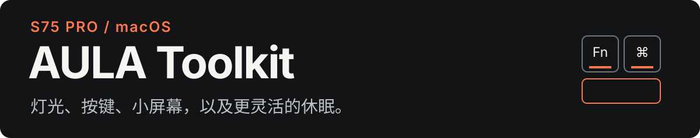
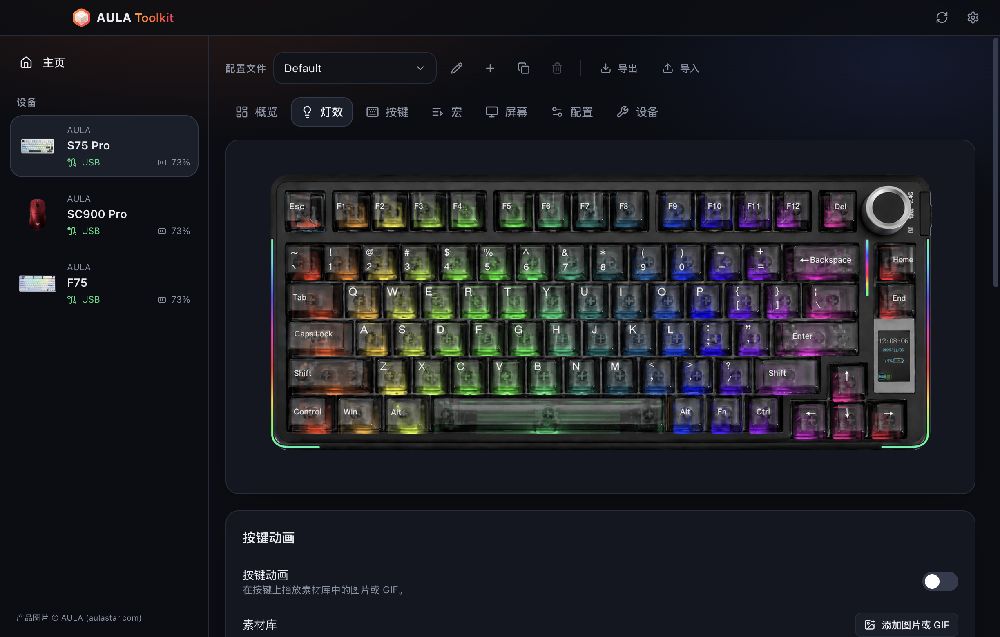
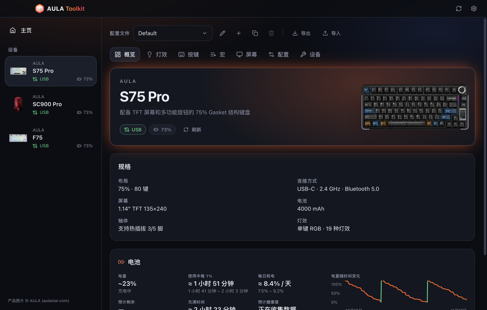

<p align="center">
  
</p>

# AULA Toolkit for macOS

**让 S75 Pro 在 Mac 上也有完整的配置界面。** 这个非官方分支基于 [livvaa/AulaToolkit](https://github.com/livvaa/AulaToolkit)，保留原项目的键盘、鼠标、配置文件和命令行功能，重点适配并实测 AULA S75 Pro。

[下载 0.3.0](https://github.com/Stanley-baby/AulaToolkit/releases/tag/v0.3.0) · [Mac 安装与权限](docs/macos.md) · [F106 固件说明](firmware/s75pro/README.md) · [已知问题](#已知问题)

> Unofficial macOS fork of AulaToolkit. Configure lighting, keys, macros, the S75 Pro screen and hardware sleep. See the [English macOS guide](docs/macos.md).



*截图来自真实运行的 App，使用隔离的模拟设备展示界面；实机验证范围另列于下方。*

## 一套界面，管理这些事情

- **灯光**：主灯与侧灯模式、单键配色、有线单键呼吸；USB 下显示实体灯光读回预览。
- **按键与宏**：基础层、Fn 层改键，录制和编辑宏，保存多份配置。
- **动画与小屏幕**：在按键上播放图片或 GIF，选择方向和平均取色；通过 USB 上传 TFT 图片与 GIF、同步时间。
- **Mac 使用体验**：原生窗口按钮、可调整窗口、深浅主题、中文界面、菜单栏与 Dock、系统音频灯效、备份及诊断。
- **F106 硬件休眠**：自定义 1～120 分钟，选择深睡、快速唤醒，或先关闭灯屏再进入深睡。
- **App 内升级**：选择已核验固件，查看准备、擦除、写入、校验和重连进度；提供 F105 上一版恢复入口。



## 从这里开始

1. 在 [Releases](https://github.com/Stanley-baby/AulaToolkit/releases) 下载与你的 Mac 架构对应的 DMG：Apple Silicon 选 `arm64`，Intel 选 `x64`。
2. 将 **AULA Toolkit.app** 拖到“应用程序”，打开 App。要求 **macOS 14.2 或更新版本**。
3. 使用支持数据传输的 USB 线连接 S75 Pro，切到有线模式，确认 App 识别设备。
4. 先试用灯效或保存一份配置。**普通配置不要求刷写 F106**；自定义硬件休眠和快速唤醒需要配套固件。

本次 Mac 安装包使用临时自签名，未经过 Apple 公证。若系统拦截，请按 [Mac 安装说明](docs/macos.md#opening-the-app) 在“隐私与安全性”中手动允许。系统音频灯效所需的录音权限，以及 HID 访问所需的权限，也在该说明中列出。

## 连接方式决定可用功能

| 功能 | USB 有线 | 2.4 GHz | 蓝牙 |
| --- | :---: | :---: | :---: |
| 配置主灯、侧灯、改键、宏 | ✓ | ✓ | 先经 USB／2.4G 设置 |
| 实时灯光读回、按键动画、单键呼吸 | ✓ | — | — |
| 上传 TFT 图片／GIF | ✓ | — | — |
| 设置 F106 休眠策略 | ✓ | ✓ | 先经 USB／2.4G 设置 |
| 使用已保存的 F106 休眠策略 | ✓* | ✓ | ✓ |
| 固件升级与恢复 | ✓ | — | — |

\* 完整灯屏自动熄灭及快速唤醒的实机验收重点为拔掉 USB 的无线模式；有线／充电状态可能保留灯屏，不等同于无线低功耗行为。

S75 Pro 已完成有线与无线功能的多轮人工验收。F75、SC900 Pro 等原项目设备的驱动和编辑界面继续保留，**本分支没有逐一完成它们的 Mac 实机验收**。

## F106：让休眠由你选择


| 策略 | 达到设定时间后 | 再次打字时 |
| --- | --- | --- |
| 深睡 | 关闭灯屏，进入原版深睡路径 | 可能需要唤醒或重连等待 |
| 快速唤醒 | 关闭灯屏，保留无线通信与按键扫描 | 已测蓝牙／2.4G 可完整输入，无明显重连等待 |
| 分阶段休眠 | 先关闭灯屏，累计空闲达到第二个时间后深睡 | 第一阶段快速响应，深睡后恢复原版等待行为 |

例如设置 **3 分钟关闭灯屏、5 分钟进入深睡**：两个时间都从最后一次按键起计算，完整输入会重新计时。设置保存在键盘中，App 退出后仍生效。快速唤醒保留无线工作状态；其实际电流和续航差异尚未测量。

本次提供 **F106 主版本 + F105 上一版**，包含二进制、文件指纹、补丁源代码和复现构建脚本。只针对已核对的 S75 Pro 硬件版本；请先阅读 [固件安装、恢复和验证记录](firmware/s75pro/README.md)。

## 已知问题

- **渐灭尾段偏色**：`#ff4747` 的单键渐灭尾段仍可能偏红。两种补偿实验均未解决，因此未收入本次发布。
- **偶发亮度提示**：动态灯效的明暗可能被旧监测逻辑误判为亮度变化。该项修复尚未发布；可在“设置 → 通知”中暂时关闭屏幕提示。
- **侧灯选色**：已验证流动、轮换、常亮和关闭；常亮颜色沿用键盘自身设置，尚未实现任意 RGB 直接选色。
- **Mac 熄屏与键盘休眠不同**：App 可随 Mac 熄屏关闭主灯和侧灯；小屏幕完整熄灭仍依赖键盘的休眠计时。
- **版本标识不是完整读回**：支持识别已核对的固件版本标识；无法完整读回键盘上的屏幕素材、所有配置或原始固件。

## 构建与参与

```sh
npm ci
npm run typecheck
npm test
npm run dist:mac
```

本机生成当前架构的 DMG 和 ZIP；CI 分别检查 Apple Silicon、Intel 与 Windows。更多权限、命令行、签名及平台差异见 [macOS 指南](docs/macos.md)。故障反馈请附“设置 → 关于”导出的诊断包；提交前可先查看其中的设备和日志内容。

欢迎通过 [Pull Request](https://github.com/Stanley-baby/AulaToolkit/pulls) 提交修复，也可参考 [贡献说明](CONTRIBUTING.md)。原项目其他语言文档：[Türkçe](README_tr-TR.md) · [Русский](README_ru-RU.md)，其内容可能尚未覆盖此分支的 Mac 与固件改动。

## 来源与许可

原项目由 **[Livvaa](https://github.com/livvaa/AulaToolkit)** 创建，本仓库提供 macOS 适配与 S75 Pro 配套固件工作。协议研究参考 [open-aula](https://github.com/paulcoding810/open-aula)、[AulaSofwareLinux](https://github.com/thought-train/AulaSofwareLinux)、[IncottHIDApp](https://github.com/romkazor/IncottHIDApp) 和 [OpenMouse](https://github.com/OpenMouse-Project/mouse-protocol)。

应用代码按 [GPL-3.0-or-later](LICENSE) 提供。固件包含第三方厂商二进制，来源及本仓库补丁的范围见 [固件说明](firmware/s75pro/README.md#来源与范围)。产品名称、商标及原始产品图片归各自权利人；本项目与 AULA 无隶属关系。
