

  <picture>
    <source media="(prefers-color-scheme: dark)" srcset="docs/brand/wordmark-dark.png">
    
  </picture>

  
  
  
   
  
  
  
  
   
  
  
  

> [!NOTE]
> Этот README переведён с английского машинным переводом, сам я по-русски не говорю. Если русский ваш родной язык и вы видите ошибки, буду рад помощи (issue или PR).

## 🚨 Статус проекта

> [!IMPORTANT]
> - AULA Toolkit находится на **ранней стадии разработки** (версия 0.x). Возможны шероховатости.
> - Это **неофициальный** проект, **не связанный с AULA**. Названия и изображения продуктов принадлежат их владельцам.
> - На реальном оборудовании проверены только некоторые устройства; см. [Совместимость](#совместимость).

#### Этот README на других языках:
* [English README](README.md)
* [Türkçe README](README_tr-TR.md)

---

AULA Toolkit — приложение для Windows, которое управляет клавиатурами и мышами AULA из одного окна, в духе Logitech G HUB. Оно заменяет отдельные драйверы, которые AULA выпускает для каждой модели.

Оно не устанавливает фоновых служб, не собирает телеметрию и выходит в интернет только для проверки обновлений на GitHub. Изменения записываются в устройство сразу же и хранятся в его собственной памяти, поэтому они работают и на других компьютерах, и через Bluetooth.

# Скриншоты

### Главная и обзор устройства
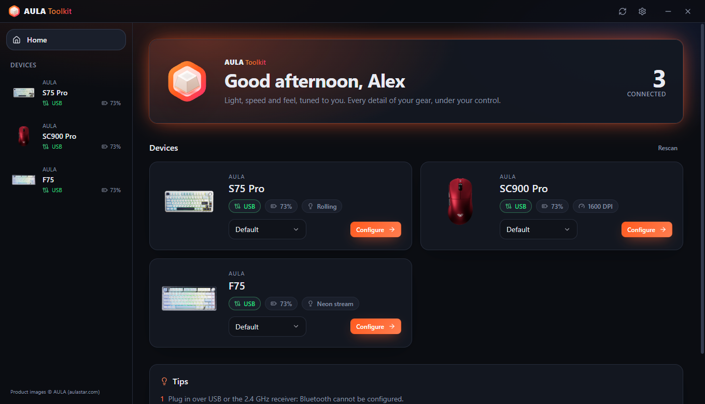 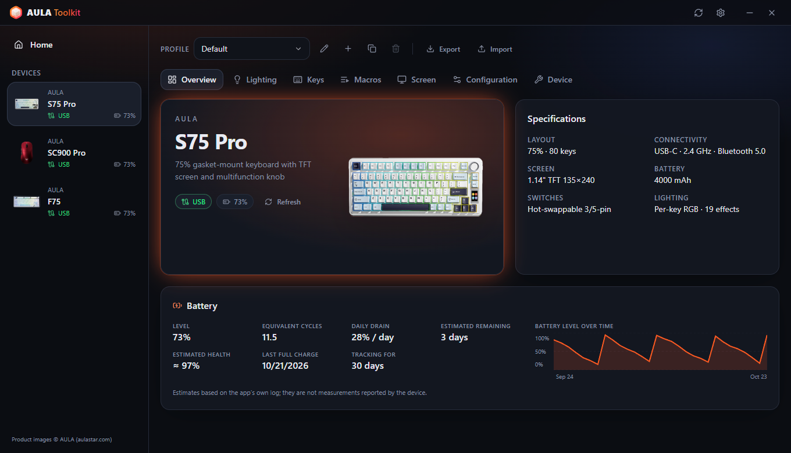

### Клавиатуры
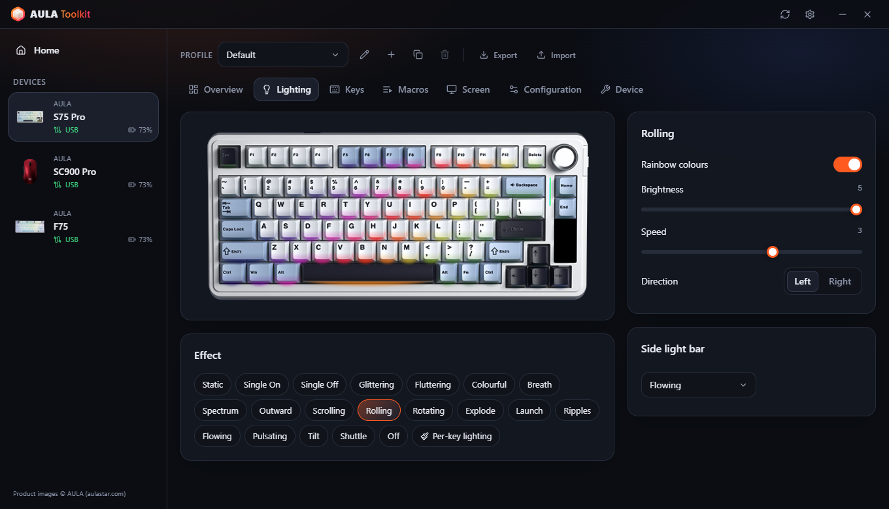 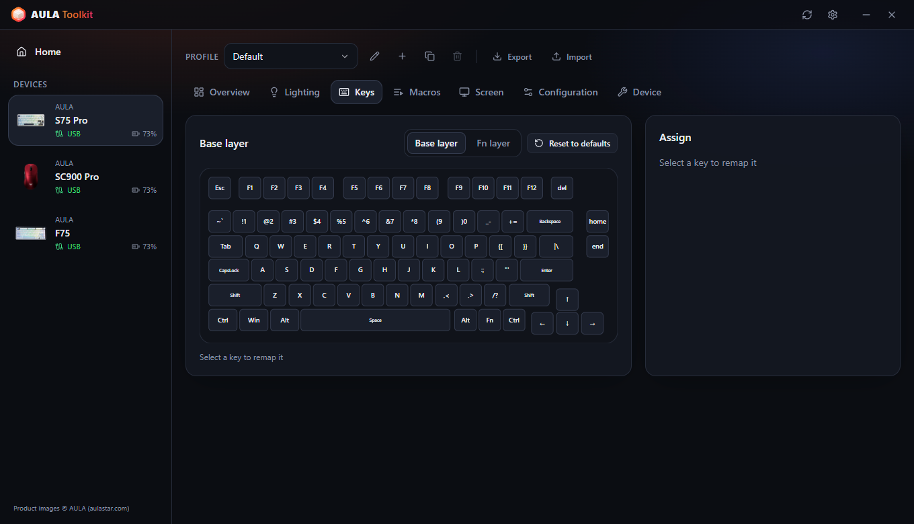
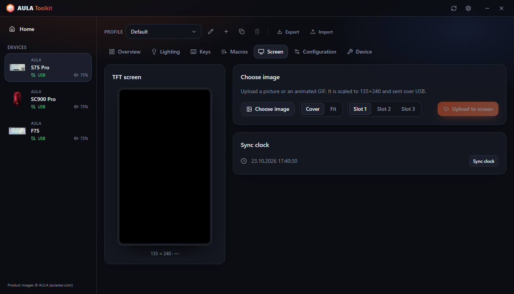 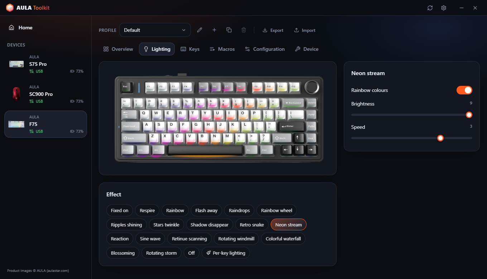

### Мыши
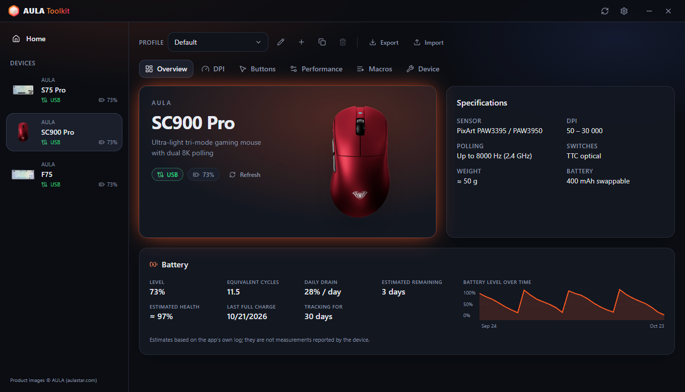 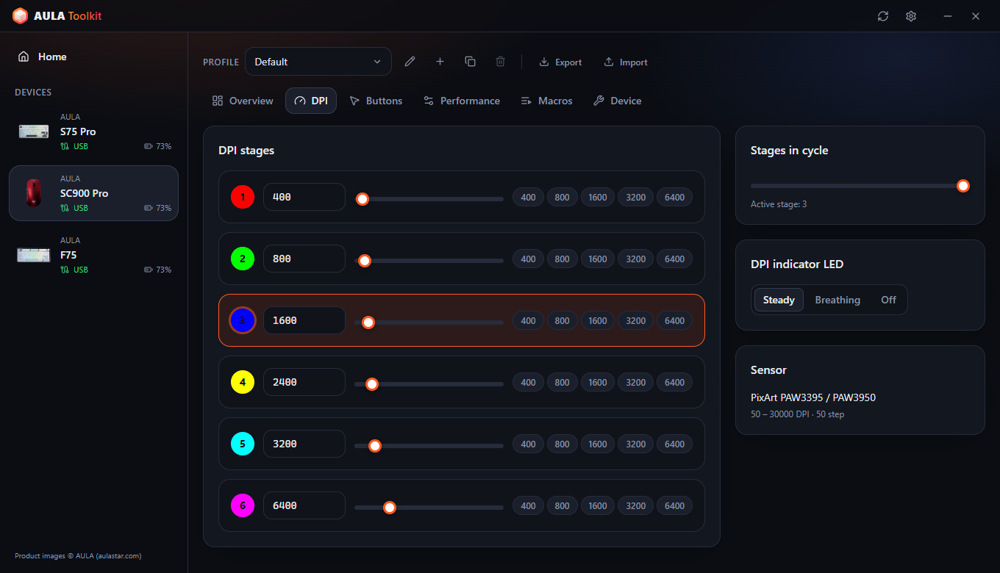
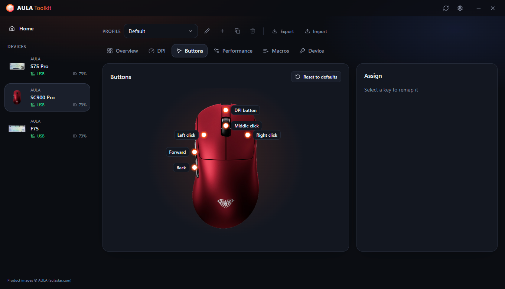 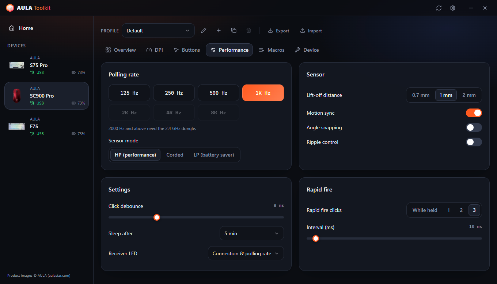

### Сводка в трее и экранный индикатор
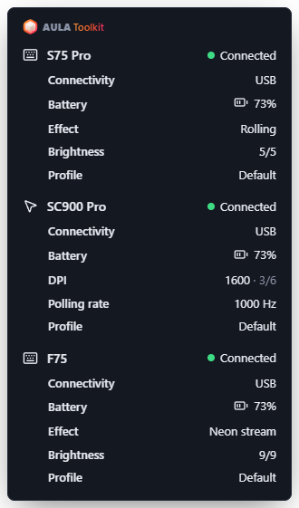 &nbsp; 

### Настройки
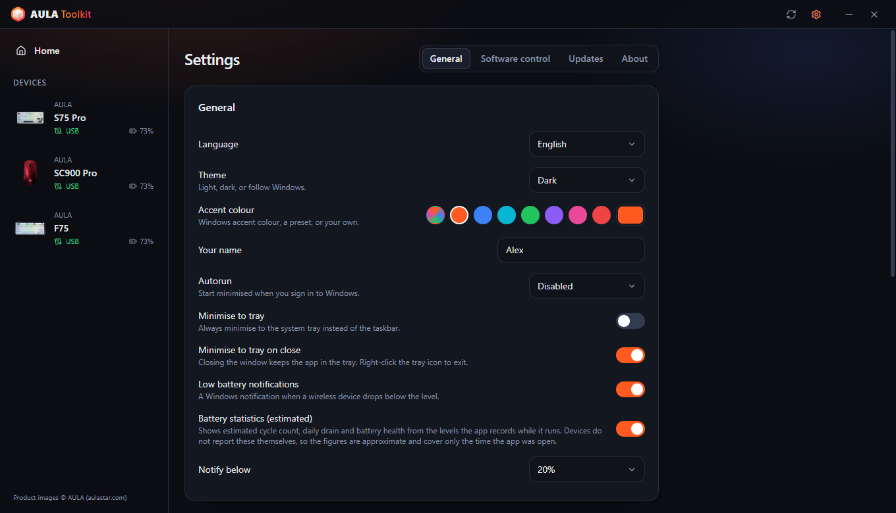 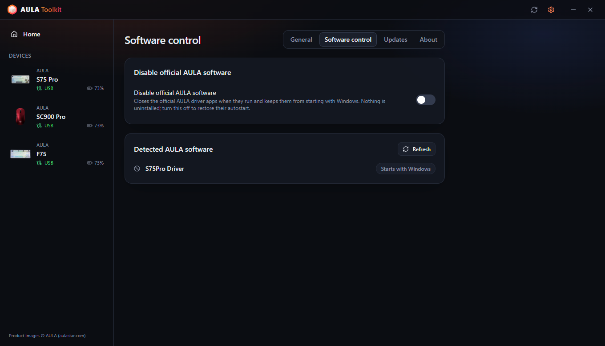
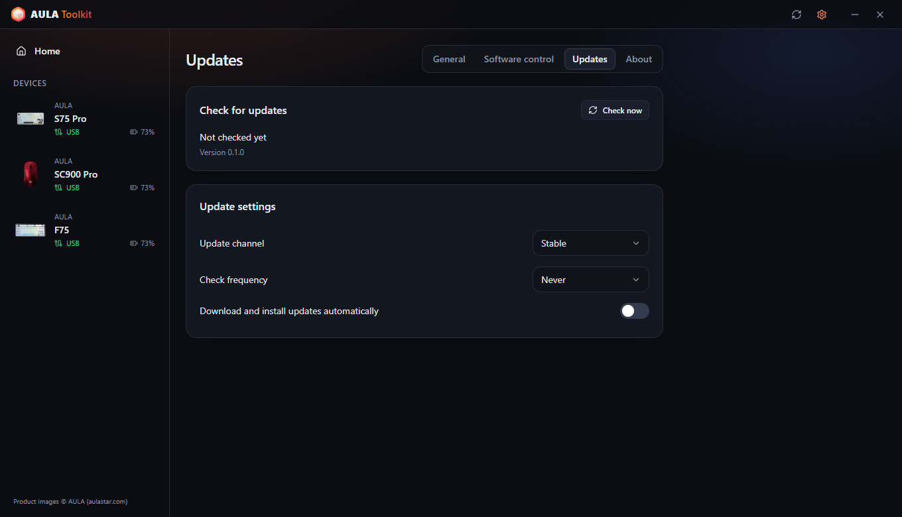 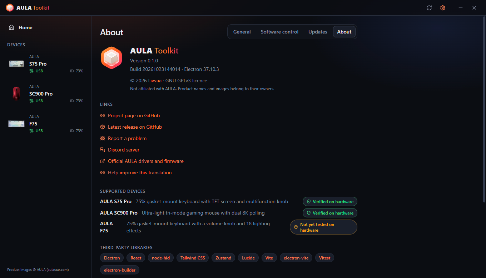
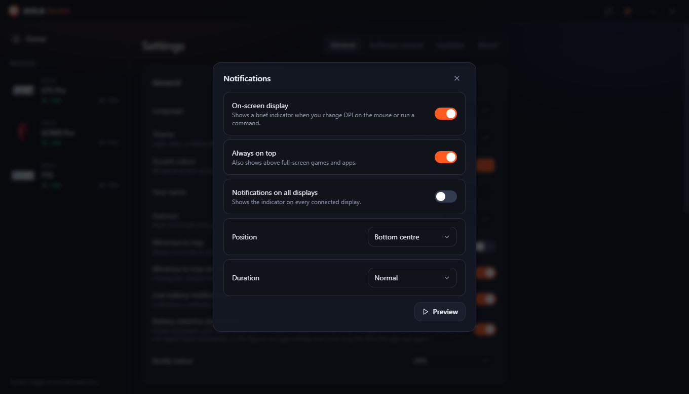 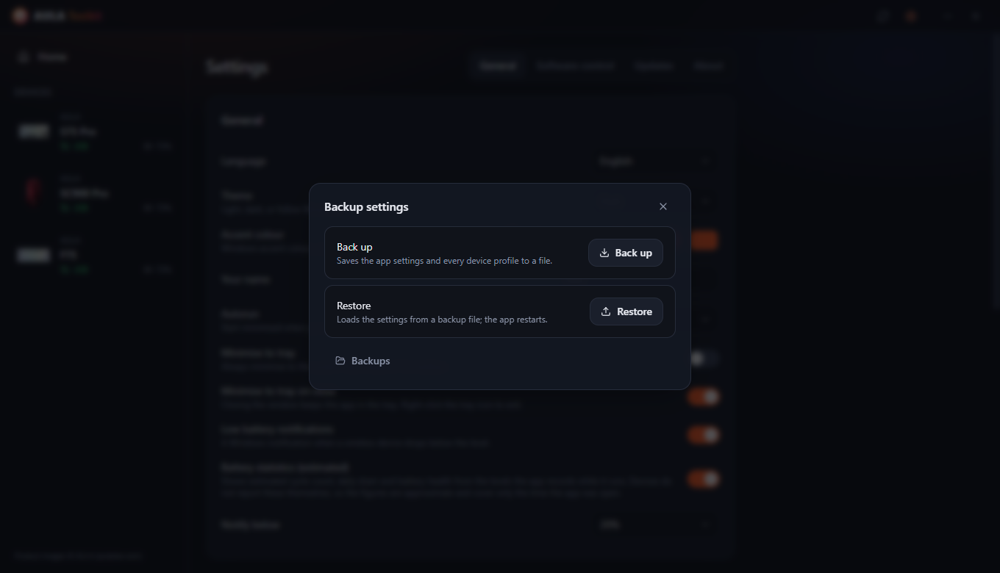

---

# Содержание
  - [Отказ от ответственности](#отказ-от-ответственности)
  - [Скачать](#скачать)
  - [Совместимость](#совместимость)
  - [Возможности](#возможности)
  - [Благодарности](#благодарности)
  - [Вопросы и ответы](#вопросы-и-ответы)
  - [Аргументы запуска](#аргументы-запуска)
  - [Как собрать журналы?](#как-собрать-журналы)
  - [Участие в разработке](#участие-в-разработке)
  - [Лицензия](#лицензия)

## Отказ от ответственности

**Программа поставляется без каких-либо гарантий. Используйте на свой страх и риск.**

AULA Toolkit общается с устройствами по протоколам, восстановленным путём анализа официальных драйверов. Прежде чем сообщать о проблеме, прочитайте этот файл — в нём есть ответы на самые частые вопросы.

## Скачать

В каждом выпуске публикуются две сборки:
* **Установщик** — устанавливает программу только для текущего пользователя, поэтому права администратора не нужны.
* **Портативная** — один файл `.exe`, который запускается без установки.

#### Обновление

AULA Toolkit умеет обновляться сам. Настройте это в разделе **Настройки → Обновления**:
* **Канал** — **Стабильный** или бета-выпуски.
* **Частота проверки** — от каждого часа до раза в месяц, или никогда.
* **Скачивать и устанавливать обновления автоматически** — обновления загружаются в фоне и устанавливаются при закрытии приложения. Их также можно установить сразу.

При установке новой версии поверх старой ваши настройки, профили и макросы сохраняются.

#### Что дальше

AULA Toolkit лучше всего работает в трее. В разделе **Настройки → Общие**:
1. Установите **Автозапуск** в значение *Включено* (или *Включено (с задержкой)*, чтобы запускаться через 30 секунд после входа).
2. Включите **Сворачивать в трей при закрытии**.
3. В разделе **Настройки → Контроль ПО** включите **Отключить официальное ПО AULA**, чтобы драйверы AULA не конфликтовали с AULA Toolkit за одно и то же устройство.

> [!WARNING]
> Если полностью закрыть AULA Toolkit, перестанут работать функции, которым нужно запущенное приложение: экранный индикатор, уведомления о батарее, сводка в трее, музыкальный ритм и анимации на клавишах, а также команда `aula`. Настройки, уже записанные в устройства, продолжат работать.

## Совместимость

| Устройство | Подключение | Статус |
|---|---|---|
| **AULA S75 Pro** | USB, приёмник 2.4 ГГц, Bluetooth (статус и батарея) | ✅ Проверено на оборудовании |
| **AULA SC900 Pro** | USB, приёмник 2.4 ГГц, Bluetooth (статус и батарея) | ✅ Проверено на оборудовании |
| **AULA SC900** (другие версии с драйвером SC900 Pro) | USB, приёмник 2.4 ГГц | ⚠️ Распознаётся, на оборудовании ещё не проверено |
| **AULA F75** | USB | ⚠️ Распознаётся, на оборудовании ещё не проверено |

AULA продаёт одну и ту же мышь в нескольких цветах под одним USB ID, поэтому AULA Toolkit не может их различить. Выберите свой цвет при настройке устройства или на вкладке **Устройство**.

Вашего устройства AULA нет в списке? Возможно, оно всё равно использует один из протоколов выше — см. [Можно ли добавить поддержку моего устройства AULA?](#можно-ли-добавить-поддержку-моего-устройства-aula).

#### Что работает при каком подключении

| Функция | S75 Pro · USB | S75 Pro · 2.4 ГГц | SC900 Pro · USB / 2.4 ГГц | F75 · USB |
|---|:---:|:---:|:---:|:---:|
| Эффекты подсветки | ✅ | ✅ | — | ✅ |
| Поклавишная подсветка | ✅ | ✅ | — | — |
| Музыкальный ритм и анимация на клавишах (передаются с ПК) | ✅ | — | — | — |
| Выключение подсветки, пока монитор выключен | ✅ | ✅ | — | — |
| Живой вид клавиатуры, отслеживание изменений крутилкой / Fn | ✅ | — | — | — |
| Назначение клавиш, слой Fn, макросы | ✅ | ✅ | — | ✅ |
| Настройки клавиатуры (блокировка Win, сон, антидребезг) | ✅ | ✅ | — | ✅ |
| TFT-экран и часы (синхронизируются при подключении) | ✅ | Только часы | — | — |
| Боковая световая полоса | ✅ | ✅ | — | — |
| DPI, частота опроса, сенсор, кнопки, макросы | — | — | ✅ | — |
| Уровень заряда | — | ✅ | ✅ | — |
| Чтение настроек с устройства при подключении | — | — | ✅ | ✅ |
| Экранный индикатор для изменений, сделанных на устройстве | ✅ | — | ✅ (кнопка DPI) | — |

> [!NOTE]
> Устройства настраиваются только через **USB** или **приёмник 2.4 ГГц**. Через Bluetooth устройство не открывает интерфейс настройки — у официального ПО AULA то же ограничение. Ранее сохранённые настройки продолжают работать через Bluetooth, а AULA Toolkit и там показывает устройство как подключённое, с уровнем заряда, который сообщает Windows.

### ПО AULA

Если официальный драйвер AULA и AULA Toolkit работают одновременно, оба обращаются к одному устройству, что может отменять изменения или вызывать ошибки чтения. Когда AULA Toolkit обнаруживает официальную программу AULA, внизу окна появляется полоса с предупреждением. **Настройки → Контроль ПО → Отключить официальное ПО AULA** полностью не даёт им запускаться: они остаются установленными, но их программы отключаются (Windows один раз запросит разрешение администратора), а записи автозапуска убираются. Если выключить этот параметр, программами снова можно пользоваться; при удалении AULA Toolkit они тоже восстанавливаются.

## Возможности

Приложение позволяет:

- Настраивать все поддерживаемые устройства из одного окна; изменения применяются сразу.
- Никогда самовольно не перезаписывать то, что уже хранится в устройстве: настройки мыши считываются при подключении, а на S75 Pro эффект, цвет и яркость, изменённые крутилкой или клавишами Fn, отслеживаются вживую и сохраняются в профиль.
- Держать несколько **профилей** для каждого устройства, экспортировать и импортировать их как файлы.
- Видеть живой **экранный индикатор** при нажатии кнопки DPI на мыши или выполнении команды.
- Воспроизводить на клавишах S75 Pro полосы **музыкального ритма** и **анимации (GIF)**, передаваемые с ПК.
- **Выключать подсветку клавиатуры, пока монитор выключен**, и включать её снова, когда он просыпается.
- Перезапускать приложение откуда угодно сочетанием **Ctrl + Alt + Shift + A**, если что-то зависло.
- Получать подробную **сводку в трее** обо всех подключённых устройствах, наведя курсор на значок.
- Получать **уведомления о низком заряде**, напоминание **ухода за батареей** на 80 % во время зарядки и при желании смотреть **статистику батареи**.
- Отключать официальное ПО AULA без его удаления.
- Управлять устройствами из **командной строки** с помощью `aula`.
- Пользоваться приложением на **10 языках**: English, Türkçe, Русский, 简体中文, Українська, Tiếng Việt, Português (Brasil), Español, Deutsch и Français.
- Выбирать **светлую, тёмную или системную тему** и акцентный цвет.

### Клавиатуры

* **Подсветка** — все аппаратные эффекты с цветом, яркостью, скоростью и направлением, а также предпросмотр на фотографии вашей клавиатуры.
* **Живой вид** (S75 Pro, USB) — изображение клавиатуры показывает, что светодиоды показывают прямо сейчас. Если сменить эффект крутилкой или клавишами Fn, приложение за несколько секунд распознаёт его, выбирает и показывает на экране. Клавиатура не сообщает свой эффект, поэтому он определяется по цветам светодиодов: эффекты, которые остаются тёмными до нажатия клавиши, в покое выглядят одинаково, а при очень быстром вращении крутилки промежуточный эффект может быть пропущен.
* **Поклавишная подсветка** (S75 Pro) — раскрашивайте клавиши по одной или заливайте всю клавиатуру.
* **Во время музыки** — полосы на клавишах следуют за звуком, который играет на ПК (12 цветовых схем, амплитуда и фон, как в официальном драйвере), или клавиатура переключается на выбранный вами эффект. Для полос нужен USB-кабель; при работе через приёмник используется эффект.
* **Анимация на клавишах** (S75 Pro, USB) — воспроизводит картинку или GIF из вашей библиотеки на клавишах, примерно 20 кадров в секунду.
* **Выключение вместе с экраном** (S75 Pro) — клавиши и боковая полоса гаснут, пока монитор выключен.
* **Назначение клавиш** — переназначайте клавиши основного слоя и слоя Fn на клавиши, кнопки мыши, мультимедийные клавиши, сочетания или макросы.
* **Макросы** — записывайте нажатия с реальными паузами и редактируйте их потом.
* **TFT-экран** (S75 Pro, USB) — загружайте картинку или анимированный GIF из библиотеки. Перетаскивайте предпросмотр, чтобы выбрать видимую часть; длинные GIF подгоняются под 141 кадр экрана без изменения скорости. Часы синхронизируются при каждом подключении клавиатуры.
* **Конфигурация** — блокируйте клавишу Windows, Alt+F4 и Alt+Tab, задавайте время сна и время отклика клавиш.
* **Сброс** — восстановите настройки клавиатуры по умолчанию или выполните полный сброс к заводским.

### Мыши

* **DPI** — до шести ступеней, активная ступень, число ступеней в цикле и светодиод индикатора DPI.
* **Частота опроса** — до 8000 Гц. Частоты выше 1000 Гц требуют приёмник 2.4 ГГц.
* **Сенсор** — высота отрыва, motion sync, коррекция углов, подавление дрожания и режим сенсора.
* **Кнопки** — переназначайте любые кнопки, кроме левой, включая автоогонь и макросы.
* **Тайминги** — антидребезг клика и время сна.
* **Батарея** — уровень и состояние зарядки. Две батареи SC900 Pro (и любые добавленные запасные) учитываются отдельно.

### Экранный индикатор

Когда вы меняете DPI кнопкой на мыши, на экране появляется небольшой индикатор с новым значением и активной ступенью. На S75 Pro (USB) он также показывает новый эффект, цвет или яркость, изменённые на клавиатуре, и подтверждает изменения, сделанные командой `aula`. Ещё он показывает ход загрузки на экран, напоминание об уходе за батареей и перезапуск. В разделе **Настройки → Уведомления** его можно выключить, выбрать положение и длительность, держать поверх полноэкранных игр или показывать на всех мониторах.

### Резервные копии

**Настройки → Резервная копия** сохраняет настройки приложения и все профили устройств в один файл и позже восстанавливает их из него, например после переустановки Windows.

### Статистика батареи

Включите **Настройки → Общие → Статистика батареи (оценка)**, чтобы видеть карточку батареи в обзоре каждого устройства:

* **Уровень** — текущий уровень или последний известный с указанием, как давно он был прочитан. На кабеле без показаний — оценка, затем 99+.
* **1 % при работе** — сколько длится 1 %, пока устройство используется через приёмник.
* **Расход в день** и **Осталось (оценка)** — по календарному времени, включая часы сна и время, когда приложение закрыто.
* **Полная зарядка** и **Состояние (оценка)** — по тому, как быстро батарея заряжается в середине диапазона.
* **Эквивалентные циклы**, **Последняя полная зарядка** и график уровня во времени.

Значения показываются с диапазоном, когда накоплено достаточно данных. Уровни записываются через USB, приёмник 2.4 ГГц и Bluetooth (из Windows). **Уход за батареей**, по умолчанию включённый вместе со статистикой, напоминает отключить устройство, когда заряд дойдёт до 80 %.

> [!NOTE]
> Устройства AULA сообщают только процент заряда. Все значения выше — **оценки**, рассчитанные по уровням, которые записывает AULA Toolkit.

> [!WARNING]
> Не используйте быстрые зарядные устройства, так написано на коробках.

### Командная строка

AULA Toolkit можно управлять из командной строки. Команда называется `aula` и устанавливается в `resources\bin` внутри папки установки (по умолчанию `%LOCALAPPDATA%\Programs\AULA Toolkit\resources\bin\aula.cmd`). Добавьте эту папку в `PATH`, чтобы вызывать команду откуда угодно. Точный путь с кнопкой копирования показан в разделе **Настройки → Общие → Командная строка**.

Команда обращается к запущенному приложению. Если AULA Toolkit не запущен, `aula` сначала запускает его в трее. Права администратора не нужны.

Команды

* `aula status` — список подключённых устройств (добавьте `--json` для машиночитаемого вывода)
* `aula profile list` — список профилей устройства
* `aula profile set <name>` — переключиться на профиль
* `aula dpi` — показать ступени DPI мыши
* `aula dpi stage <n>` — включить ступень DPI `<n>` (нумерация с 1)
* `aula dpi <value>` — задать активной ступени значение `<value>` DPI
* `aula polling <hz>` — задать частоту опроса мыши
* `aula light list` — список эффектов клавиатуры
* `aula light <effect> [--color #rrggbb] [--brightness n] [--speed n]` — задать эффект клавиатуры
* `aula brightness <n>` — задать яркость подсветки клавиатуры
* `aula osd on|off` — включить или выключить экранный индикатор
* `aula show` / `aula hide` — показать или скрыть окно
* `aula version` — вывести версию приложения

Если подключено несколько устройств одного типа, выберите нужное через `-d <id>`, например `aula profile list -d sc900`. Команда завершается с кодом `0` при успехе и `1` при ошибке, поэтому её можно использовать в скриптах.

## Благодарности

AULA Toolkit создаёт и поддерживает **Livvaa** ([GitHub](https://github.com/Livvaa)).

Особая благодарность проектам, чья открытая работа по анализу протоколов сделала это возможным:
* [open-aula](https://github.com/paulcoding810/open-aula) — протоколы клавиатур AULA.
* [AulaSofwareLinux](https://github.com/thought-train/AulaSofwareLinux) — протокол семейства AULA F75.
* [IncottHIDApp](https://github.com/romkazor/IncottHIDApp) и [OpenMouse](https://github.com/OpenMouse-Project/mouse-protocol) — протокол мышей PixArt 8K.

Все детали протоколов сверены с официальными драйверами AULA. Изображения продуктов © AULA ([aulastar.com](https://www.aulastar.com)).

### Сторонние библиотеки

* **Electron** ([electron/electron](https://github.com/electron/electron))
* **React** ([facebook/react](https://github.com/facebook/react))
* **node-hid** ([node-hid/node-hid](https://github.com/node-hid/node-hid))
* **Tailwind CSS** ([tailwindlabs/tailwindcss](https://github.com/tailwindlabs/tailwindcss))
* **Zustand** ([pmndrs/zustand](https://github.com/pmndrs/zustand))
* **Lucide** ([lucide-icons/lucide](https://github.com/lucide-icons/lucide))
* **electron-vite** ([alex8088/electron-vite](https://github.com/alex8088/electron-vite)), **Vite** ([vitejs/vite](https://github.com/vitejs/vite)) и **Vitest** ([vitest-dev/vitest](https://github.com/vitest-dev/vitest))
* **electron-builder** и **electron-updater** ([electron-userland/electron-builder](https://github.com/electron-userland/electron-builder))

### Переводы

Интерфейс доступен на 10 языках. Не все переводы пока проверены носителями языка. Если вы заметили ошибку, откройте pull request — каждый язык находится в одном файле в [`src/shared/locales`](src/shared/locales).

## Вопросы и ответы

#### Почему нельзя менять настройки через Bluetooth?

Через Bluetooth клавиатура и мышь видны Windows только как стандартные клавиатура и мышь. Интерфейса настройки, который есть при подключении по USB и через приёмник 2.4 ГГц, там нет, поэтому ни AULA Toolkit, ни официальное ПО не могут менять настройки. Подключитесь кабелем или через приёмник, внесите изменения и вернитесь на Bluetooth — настройки останутся в устройстве. Через Bluetooth AULA Toolkit показывает подключение и уровень заряда, который сообщает Windows.

#### Почему клавиатура не показывает уровень заряда?

S75 Pro сообщает уровень заряда через приёмник 2.4 ГГц, а через Bluetooth его сообщает Windows. По USB клавиатура заряжается и прошивка не сообщает уровень: AULA Toolkit показывает оценку по измеренной скорости зарядки, затем 99+.

#### Почему циклы и состояние батареи — только оценки?

В устройствах AULA нет микросхемы батареи, которая считает циклы или измеряет износ. Они сообщают только процент, поэтому всё остальное AULA Toolkit оценивает по тому, когда этот процент меняется. Состояние рассчитывается по скорости зарядки, поэтому для него нужно несколько зарядок в течение месяца или дольше.

#### Может ли AULA Toolkit прочитать картинку на экране S75 Pro или версию прошивки?

Нет. Прошивка клавиатуры может принять картинку, но не имеет команды, чтобы отдать её обратно, и ни одно из поддерживаемых устройств не сообщает версию прошивки. Официальное ПО тоже этого не умеет.

#### Почему Windows предупреждает меня при запуске установщика?

Установщики пока не подписаны цифровой подписью, поэтому Windows SmartScreen показывает предупреждение о неизвестном издателе. AULA Toolkit — проект с открытым исходным кодом, и вы можете собрать его сами из этого репозитория. Чтобы продолжить, выберите **Подробнее → Выполнить в любом случае**.

#### Моя мышь другого цвета, чем на картинке.

AULA использует один и тот же USB ID для всех цветов модели. Выберите свой цвет на вкладке **Устройство**.

#### Можно ли добавить поддержку моего устройства AULA?

Возможно. Большинство клавиатур и мышей AULA используют одно из семейств протоколов, которые AULA Toolkit уже поддерживает. Что указать в запросе, см. в разделе [Участие в разработке](#участие-в-разработке).

## Аргументы запуска

* `--hidden` — запуск свёрнутым в трей. Используется *Автозапуском*.
* `--delayed` — подождать 30 секунд перед подключением к устройствам. Используется режимом *Автозапуск → Включено (с задержкой)*.

## Как собрать журналы?

Журналы очень помогают при любой проблеме. **Всегда** прикладывайте их к своим обращениям.

#### Способ 1: пакет диагностики (рекомендуется)
1. Откройте **AULA Toolkit**.
2. Перейдите в **Настройки → О программе**.
3. Нажмите **Сохранить пакет диагностики**. В один файл, который можно приложить к обращению, сохраняются состояние устройств и журнал обмена данными.

#### Способ 2: файлы журналов
1. Воспроизведите проблему.
2. Откройте «Выполнить» (Win+R), введите `"%APPDATA%\AULA Toolkit\logs"` и нажмите ОК.
3. Приложите самый новый файл `hid-<дата>.log`.

Журнал также можно смотреть вживую в разделе **Настройки → Общие → Дополнительно**.

## Участие в разработке

Отзывы очень приветствуются, поэтому смело сообщайте о проблемах. Pull request'ы тоже приветствуются. Пожалуйста, сначала прочитайте [руководство для участников](CONTRIBUTING.md).

Есть вопросы, идеи или просто хотите пообщаться? Присоединяйтесь к [серверу Discord](https://discord.gg/u9FbaJGtCe).

#### Поддержка устройств

Для поддержки новых устройств AULA нужны тестировщики. Открывая запрос, укажите:

1. Полное название модели (например, *AULA F87 Pro*).
2. USB ID из **Диспетчер устройств → ваше устройство → Сведения → ИД оборудования** (например, `VID_0C45&PID_800A`).
3. Какое подключение вы использовали (USB или 2.4 ГГц).
4. Пакет диагностики (см. [Как собрать журналы?](#как-собрать-журналы)).

## Лицензия

Copyright (C) 2026 Livvaa

AULA Toolkit — свободное программное обеспечение: вы можете распространять и/или изменять его на условиях
GNU General Public License, опубликованной Free Software Foundation, версии 3 либо (по вашему выбору)
любой более поздней версии. Полный текст — в файле [LICENSE](LICENSE).

Эта программа распространяется в надежде, что она будет полезной, но БЕЗ КАКИХ-ЛИБО ГАРАНТИЙ; даже без
подразумеваемых гарантий ТОВАРНОЙ ПРИГОДНОСТИ или ПРИГОДНОСТИ ДЛЯ ОПРЕДЕЛЁННОЙ ЦЕЛИ.

AULA Toolkit не связан с AULA. Названия и изображения продуктов принадлежат их владельцам.
