

  <picture>
    <source media="(prefers-color-scheme: dark)" srcset="docs/brand/wordmark-dark.png">
    
  </picture>

  
  
  
   
  
  
  
  
   
  
  
  

## 🚨 Proje Durumu

> [!IMPORTANT]
> - AULA Toolkit **erken geliştirme aşamasında** (0.x sürümü). Bazı pürüzler olabilir.
> - **Resmi olmayan** bir projedir ve **AULA ile bağlantılı değildir**. Ürün adları ve görselleri sahiplerine aittir.
> - Cihazların yalnızca bir kısmı gerçek donanımda test edildi; [Uyumluluk](#uyumluluk) bölümüne bak.

#### Bu README dosyasının diğer dillerdeki sürümleri:
* [English README](README.md)
* [Русский README](README_ru-RU.md)

---

AULA Toolkit, AULA klavye ve farelerini tek bir yerden yöneten bir Windows masaüstü uygulamasıdır; Logitech G HUB anlayışıyla tasarlandı. AULA'nın her model için ayrı ayrı yayınladığı sürücülerin yerini alır.

Arka planda hiçbir hizmet çalıştırmaz, telemetri toplamaz ve internete yalnızca GitHub'da güncelleme olup olmadığını denetlemek için bağlanır. Yaptığın değişiklikler anında cihaza yazılır ve cihazın kendi belleğinde saklanır; böylece başka bilgisayarlarda ve Bluetooth üzerinden de çalışmaya devam eder.

# Ekran Görüntüleri

### Ana sayfa ve cihaz özeti
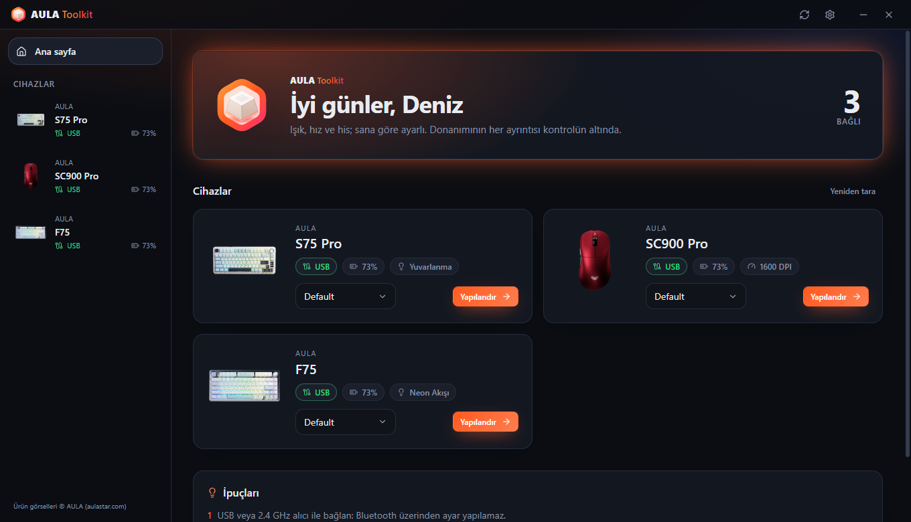 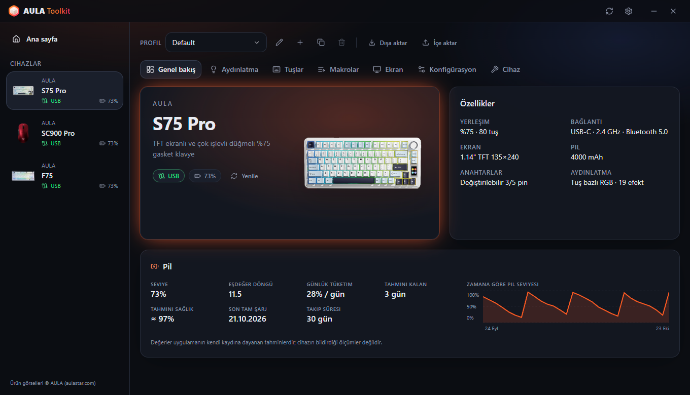

### Klavyeler
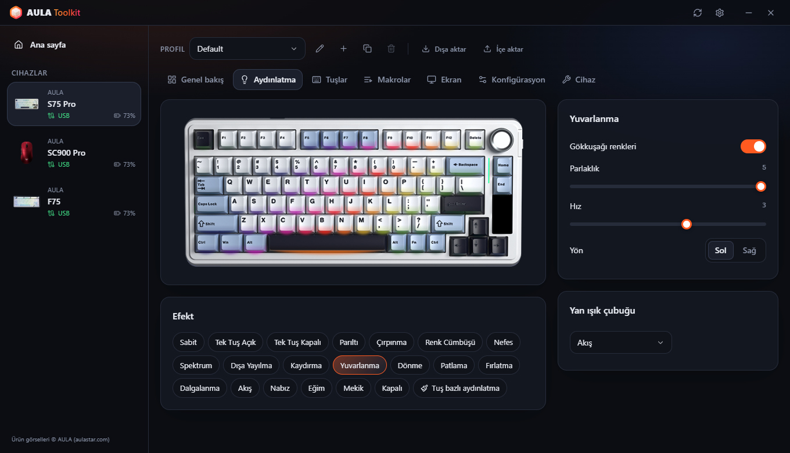 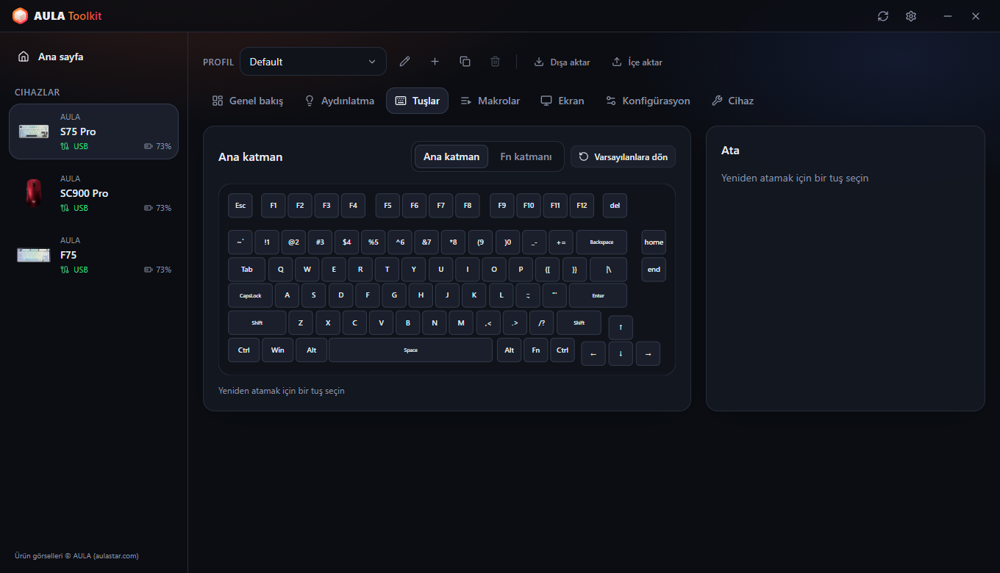
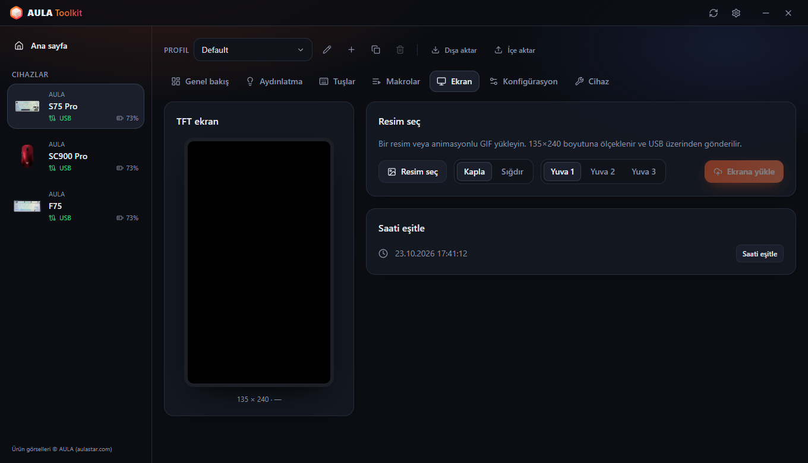 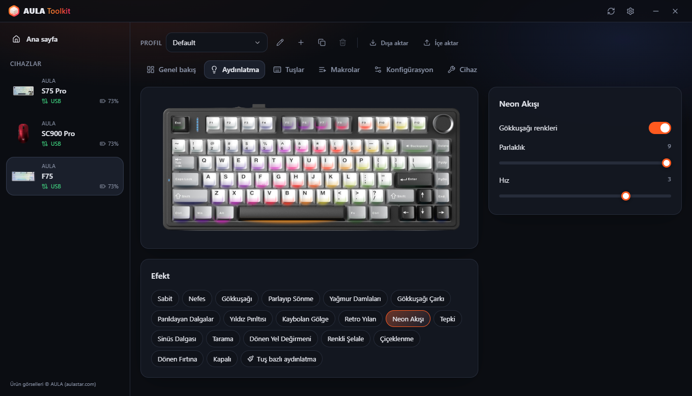

### Fareler
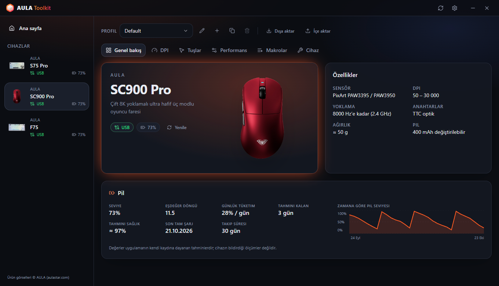 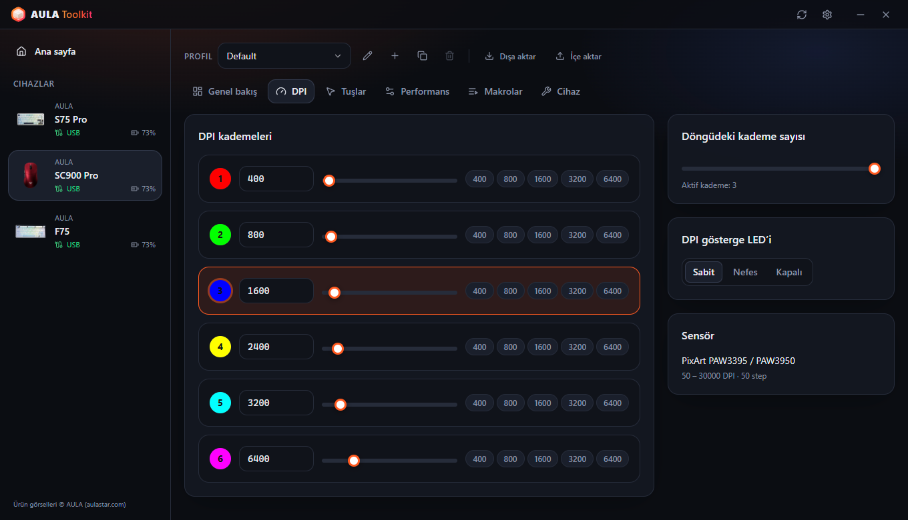
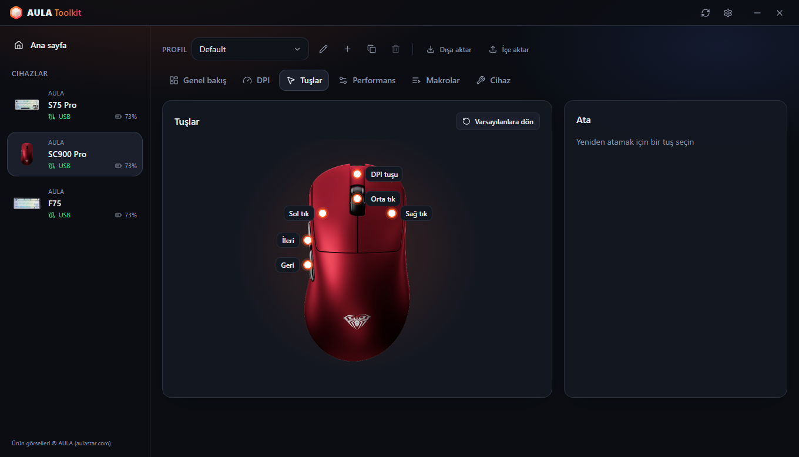 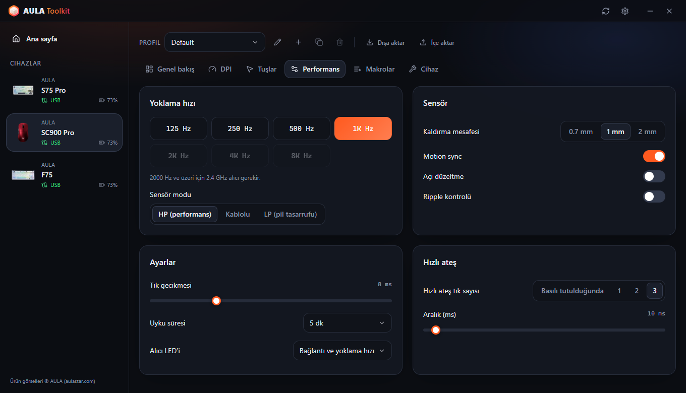

### Sistem tepsisi özeti ve ekran göstergesi
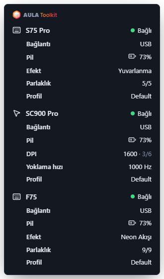 &nbsp; 

### Ayarlar
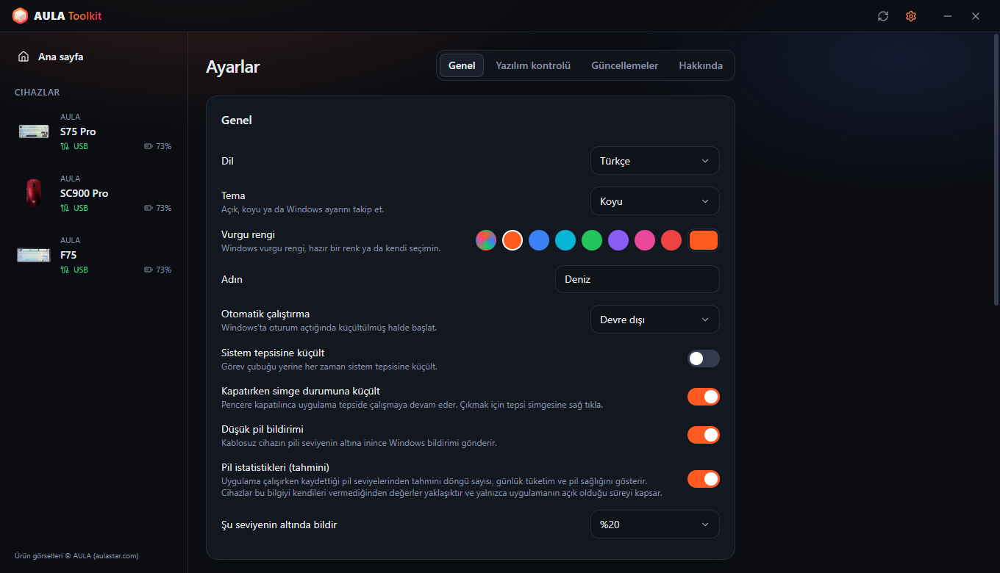 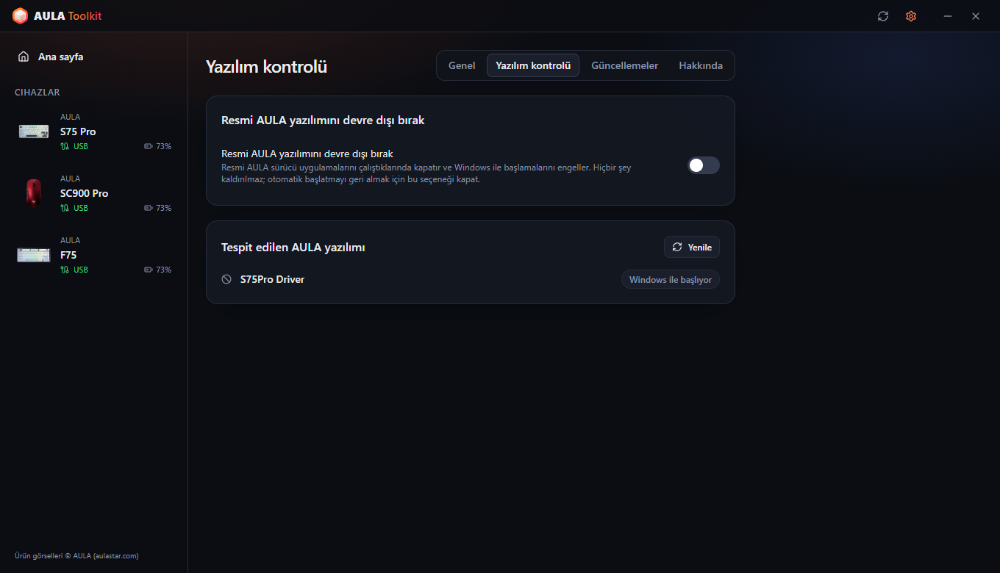
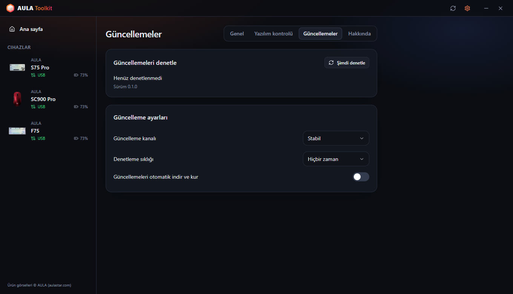 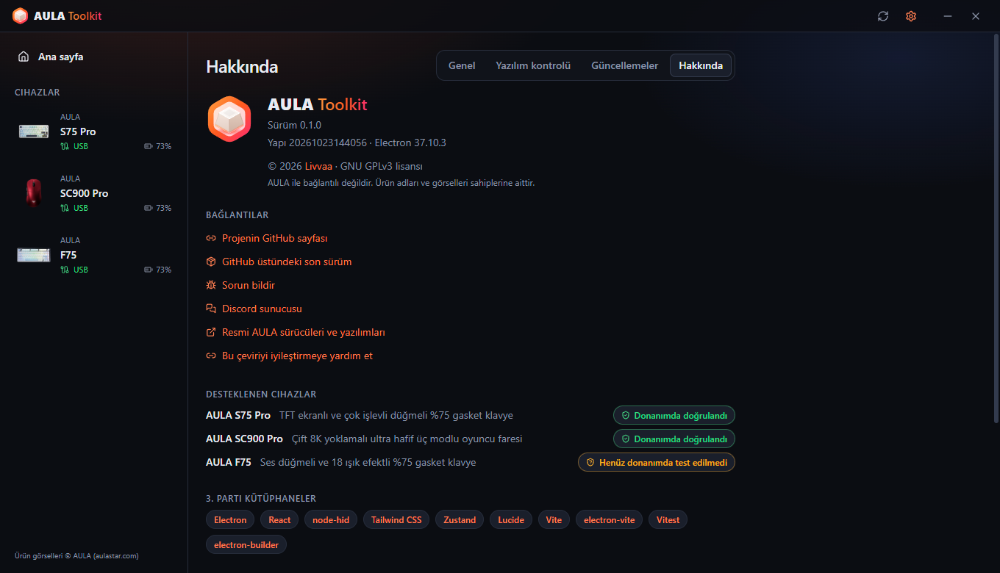
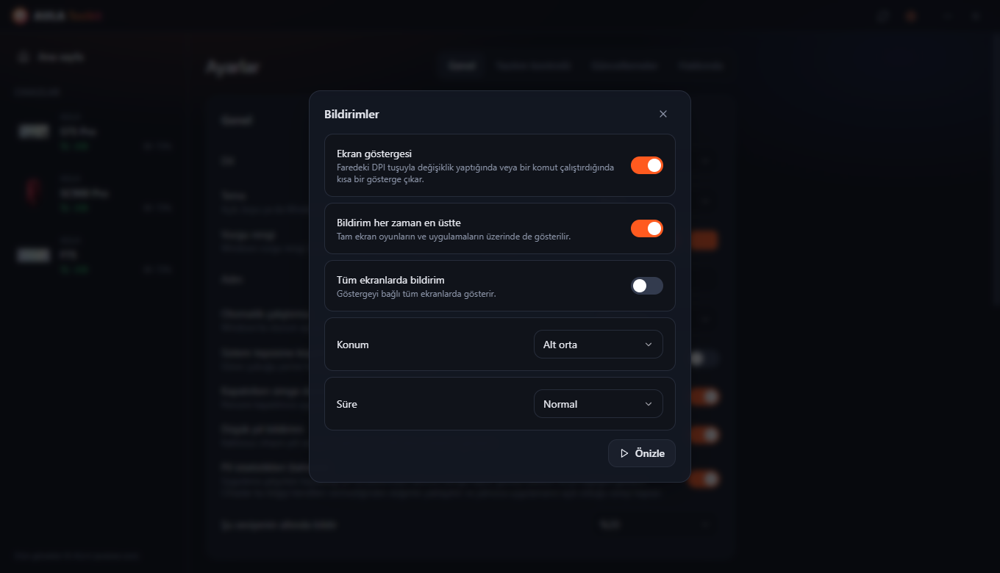 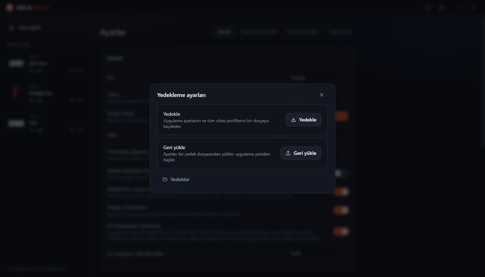

---

# İçindekiler
  - [Sorumluluk Reddi](#sorumluluk-reddi)
  - [İndirme](#i̇ndirme)
  - [Uyumluluk](#uyumluluk)
  - [Özellikler](#özellikler)
  - [Teşekkürler](#teşekkürler)
  - [SSS](#sss)
  - [Argümanlar](#argümanlar)
  - [Günlükler nasıl toplanır?](#günlükler-nasıl-toplanır)
  - [Katkıda Bulunma](#katkıda-bulunma)
  - [Lisans](#lisans)

## Sorumluluk Reddi

**Bu araç hiçbir garanti olmadan sunulur. Kullanım riski sana aittir.**

AULA Toolkit, cihazlarınla resmi sürücülerden tersine mühendislikle çıkarılmış protokoller üzerinden konuşur. Sorun bildirmeden önce lütfen bu dosyayı oku; en sık sorulan soruların yanıtları burada.

## İndirme

Her sürümde iki dosya yayınlanır:
* **Kurulum dosyası** — yalnızca mevcut kullanıcı için kurulur, bu yüzden yönetici izni gerekmez.
* **Taşınabilir sürüm** — kurulum gerektirmeden çalışan tek bir `.exe` dosyası.

#### Güncelleme

AULA Toolkit kendini güncelleyebilir. **Ayarlar → Güncellemeler** bölümünden ayarlayabilirsin:
* **Güncelleme kanalı** — **Stabil** veya **Beta** sürümler.
* **Denetleme sıklığı** — saatte birden ayda bire kadar ya da hiçbir zaman.
* **Güncellemeleri otomatik indir ve kur** — güncellemeler arka planda iner ve uygulamayı kapattığında kurulur. İstersen hemen de kurabilirsin.

Yeni sürümü mevcut sürümün üzerine kurduğunda ayarların, profillerin ve makroların korunur.

#### Sonraki adımlar

AULA Toolkit en iyi sistem tepsisinde çalışırken verim verir. **Ayarlar → Genel** bölümünde:
1. **Otomatik çalıştırma** seçeneğini *Etkin* yap (oturum açtıktan 30 saniye sonra başlaması için *Etkin (gecikmeli)* de seçebilirsin).
2. **Kapatırken simge durumuna küçült** seçeneğini aç.
3. **Ayarlar → Yazılım kontrolü** bölümünde **Resmi AULA yazılımını devre dışı bırak** seçeneğini aç; böylece AULA sürücüleri aynı cihaz için AULA Toolkit ile çakışmaz.

> [!WARNING]
> AULA Toolkit'i tamamen kapatırsan çalışmasına ihtiyaç duyan özellikler durur: ekran göstergesi, düşük pil bildirimleri, sistem tepsisi özeti, müzik ritmi ve tuşlardaki animasyonlar ve `aula` komutu. Cihazlarına daha önce yazılmış ayarlar çalışmaya devam eder.

## Uyumluluk

| Cihaz | Bağlantı | Durum |
|---|---|---|
| **AULA S75 Pro** | USB, 2.4 GHz alıcı, Bluetooth (durum ve pil) | ✅ Donanımda test edildi |
| **AULA SC900 Pro** | USB, 2.4 GHz alıcı, Bluetooth (durum ve pil) | ✅ Donanımda test edildi |
| **AULA SC900** (SC900 Pro sürücüsünü kullanan diğer sürümler) | USB, 2.4 GHz alıcı | ⚠️ Tanınıyor, henüz donanımda test edilmedi |
| **AULA F75** | USB | ⚠️ Tanınıyor, henüz donanımda test edilmedi |

AULA aynı fareyi farklı renklerde ama aynı USB kimliğiyle satıyor; bu yüzden AULA Toolkit renkleri birbirinden ayırt edemez. Rengini cihaz kurulumu sırasında ya da cihazın **Cihaz** sekmesinden seçebilirsin.

AULA cihazın listede yok mu? Yine de yukarıdaki protokollerden birini kullanıyor olabilir; [AULA cihazıma destek ekleyebilir misiniz?](#aula-cihazıma-destek-ekleyebilir-misiniz) bölümüne bak.

#### Hangi özellik hangi bağlantıda çalışır

| Özellik | S75 Pro · USB | S75 Pro · 2.4 GHz | SC900 Pro · USB / 2.4 GHz | F75 · USB |
|---|:---:|:---:|:---:|:---:|
| Işık efektleri | ✅ | ✅ | — | ✅ |
| Tuş bazlı aydınlatma | ✅ | ✅ | — | — |
| Müzik ritmi ve tuşlarda animasyon (bilgisayardan gönderilir) | ✅ | — | — | — |
| Ekran kapanınca ışıkları kapatma | ✅ | ✅ | — | — |
| Canlı klavye görünümü, düğme / Fn değişikliklerinin takibi | ✅ | — | — | — |
| Tuş atama, Fn katmanı, makrolar | ✅ | ✅ | — | ✅ |
| Klavye ayarları (Win kilidi, uyku, tuş tepki süresi) | ✅ | ✅ | — | ✅ |
| TFT ekran ve saat (bağlanınca eşitlenir) | ✅ | Yalnızca saat | — | — |
| Yan ışık çubuğu | ✅ | ✅ | — | — |
| DPI, yoklama hızı, sensör, tuşlar, makrolar | — | — | ✅ | — |
| Pil seviyesi | — | ✅ | ✅ | — |
| Bağlanınca ayarların cihazdan okunması | — | — | ✅ | ✅ |
| Cihazda yapılan değişiklikler için ekran göstergesi | ✅ | — | ✅ (DPI tuşu) | — |

> [!NOTE]
> Cihazlar yalnızca **USB** veya **2.4 GHz alıcı** üzerinden yapılandırılabilir. Bluetooth'ta cihaz yapılandırma arayüzünü açmaz; resmi AULA yazılımında da aynı kısıtlama vardır. Daha önce kaydettiğin ayarlar Bluetooth'ta da çalışmaya devam eder; AULA Toolkit de cihazı orada bağlı olarak, Windows'un bildirdiği pil seviyesiyle gösterir.

### AULA'nın yazılımı

Resmi AULA sürücüsü ve AULA Toolkit aynı anda çalışırsa ikisi de aynı cihazla konuşur; bu da değişikliklerin geri alınmasına veya okuma hatalarına yol açabilir. AULA Toolkit, resmi bir AULA programı algıladığında pencerenin altında bir uyarı şeridi gösterir. **Ayarlar → Yazılım kontrolü → Resmi AULA yazılımını devre dışı bırak** bu programların açılmasını tamamen engeller: kurulu kalırlar ama programları devre dışı bırakılır (Windows bir kez yönetici onayı ister) ve otomatik başlatma kayıtları kapatılır. Seçeneği kapattığında yeniden kullanılabilir hâle gelirler; AULA Toolkit'i kaldırdığında da geri gelirler.

## Özellikler

Uygulama ile şunları yapabilirsin:

- Desteklenen tüm cihazları tek bir pencereden yönetmek; değişiklikler anında uygulanır.
- Cihazda zaten kayıtlı olanın üzerine kendiliğinden yazmamak: farenin ayarları bağlandığında cihazdan okunur; S75 Pro'da düğmeyle veya Fn tuşlarıyla değiştirdiğin efekt, renk ve parlaklık canlı olarak algılanıp profiline kaydedilir.
- Her cihaz için birden fazla **profil** tutmak, bunları dosya olarak dışa ve içe aktarmak.
- Faredeki DPI tuşuna bastığında veya bir komut çalıştırdığında canlı **ekran göstergesi** görmek.
- S75 Pro'nun tuşlarında bilgisayardan gönderilen **müzik ritmi** barları ve **animasyonlar (GIF)** oynatmak.
- Klavye ışıklarını **monitör kapalıyken kapatmak**, ekran açılınca geri getirmek.
- Bir şey takıldığında uygulamayı her yerden **Ctrl + Alt + Shift + A** ile yeniden başlatmak.
- Sistem tepsisi simgesinin üzerine gelerek bağlı tüm cihazların ayrıntılı **tepsi özetini** görmek.
- **Düşük pil bildirimleri**, şarj olurken %80'de **pil bakımı** hatırlatması almak ve istersen **pil istatistiklerini** görmek.
- Resmi AULA yazılımını kaldırmadan devre dışı bırakmak.
- Cihazları `aula` ile **komut satırından** yönetmek.
- Uygulamayı **10 dilde** kullanmak: English, Türkçe, Русский, 简体中文, Українська, Tiếng Việt, Português (Brasil), Español, Deutsch ve Français.
- **Açık, koyu veya sistem teması** ve bir vurgu rengi seçmek.

### Klavyeler

* **Aydınlatma** — renk, parlaklık, hız ve yön ayarlarıyla tüm donanım efektleri; klavyenin fotoğrafı üzerinde önizleme.
* **Canlı görünüm** (S75 Pro, USB) — klavye resmi ışıkların o anki halini gösterir. Efekti düğmeyle veya Fn tuşlarıyla değiştirdiğinde uygulama birkaç saniye içinde tanır, seçer ve ekranda gösterir. Klavye hangi efektte olduğunu bildirmediği için bu, ışık renklerinden çıkarılır: tuşa basılana kadar karanlık kalan efektler boştayken birbirinin aynısı görünür ve düğme çok hızlı çevrilirse aradaki bir efekt atlanabilir.
* **Tuş bazlı aydınlatma** (S75 Pro) — tuşları tek tek boya ya da tüm klavyeyi doldur.
* **Müzik çalarken** — tuşlardaki barlar bilgisayarda çalan sese göre hareket eder (resmi sürücüdeki gibi 12 renk şeması, genlik ve arka plan) ya da klavye seçtiğin bir efekte geçer. Barlar USB kablosu ister; alıcıyla bağlıyken efekt kullanılır.
* **Tuşlarda animasyon** (S75 Pro, USB) — kütüphanendeki bir resmi veya GIF'i tuşlarda saniyede yaklaşık 20 kareyle oynatır.
* **Ekran kapanınca** (S75 Pro) — monitör kapalıyken tuşlar ve yan ışık çubuğu söner.
* **Tuş atama** — ana katmandaki ve Fn katmanındaki tuşları başka tuşlara, fare tuşlarına, medya tuşlarına, kısayollara veya makrolara ata.
* **Makrolar** — tuş vuruşlarını gerçek zamanlamasıyla kaydet ve sonradan düzenle.
* **TFT ekran** (S75 Pro, USB) — kütüphanenden bir resim veya hareketli GIF yükle. Görünecek kısmı önizlemeyi sürükleyerek seç; uzun GIF'ler hızı değişmeden ekranın 141 karesine sığdırılır. Saat, klavye her bağlandığında eşitlenir.
* **Konfigürasyon** — Windows tuşunu, Alt+F4 ve Alt+Tab kısayollarını kilitle; uyku süresini ve tuş tepki süresini ayarla.
* **Sıfırlama** — klavyenin varsayılan ayarlarına dön ya da tam fabrika sıfırlaması yap.

### Fareler

* **DPI** — altı kademeye kadar DPI, aktif kademe, döngüdeki kademe sayısı ve DPI gösterge LED'i.
* **Yoklama hızı** — 8000 Hz'e kadar. 1000 Hz'in üzerindeki hızlar için 2.4 GHz alıcı gerekir.
* **Sensör** — kaldırma mesafesi, motion sync, açı düzeltme, ripple kontrolü ve sensör modu.
* **Tuşlar** — sol tık hariç tüm tuşları yeniden ata; hızlı ateş ve makrolar dahil.
* **Zamanlama** — tık gecikmesi ve uyku süresi.
* **Pil** — seviye ve şarj durumu. SC900 Pro'nun iki pili (ve eklediğin yedek piller) ayrı ayrı takip edilir.

### Ekran göstergesi

Farenin kendi tuşuyla DPI'ı değiştirdiğinde ekranda yeni değeri ve aktif kademeyi gösteren küçük bir gösterge belirir. S75 Pro'da (USB) klavyeden değiştirdiğin efekti, rengi veya parlaklığı da gösterir; `aula` komutuyla yapılan değişiklikleri de bu şekilde onaylar. Ekrana yükleme, %80 hatırlatması ve yeniden başlatma da orada çıkar. **Ayarlar → Bildirimler** bölümünden kapatabilir, konumunu ve süresini seçebilir, tam ekran oyunların üzerinde ya da tüm ekranlarda gösterilmesini sağlayabilirsin.

### Yedekleme

**Ayarlar → Yedekleme ayarları** uygulama ayarlarını ve tüm cihaz profillerini tek bir dosyaya kaydeder; daha sonra, örneğin Windows'u yeniden kurduktan sonra, bu dosyadan geri yükleyebilirsin.

### Pil istatistikleri

Her cihazın genel bakış sayfasında bir pil kartı görmek için **Ayarlar → Genel → Pil istatistikleri (tahmini)** seçeneğini aç:

* **Seviye** — şu anki seviye ya da son okunan seviye ve ne kadar önce okunduğu. Kabloda okuma yoksa önce tahmin, sonra %99+.
* **Kullanımda %1** — cihaz alıcıyla kullanılırken %1'in ne kadar sürdüğü.
* **Günlük tüketim** ve **tahmini kalan** — uyku ve uygulamanın kapalı olduğu saatler dahil, takvim süresine göre.
* **Tam şarj süresi** ve **pil sağlığı** — pilin orta bölgede ne kadar hızlı dolduğundan.
* **Eşdeğer döngü**, **son tam şarj** ve zamana göre seviye grafiği.

Değerler bir aralıkla ve yeterli kayıt biriktikten sonra gösterilir. Seviyeler USB, 2.4 GHz alıcı ve Bluetooth (Windows'tan) üzerinden kaydedilir. İstatistiklerle birlikte varsayılan olarak açılan **Pil bakımı**, şarj olurken %80'de cihazı şarjdan çıkarmanı hatırlatır.

> [!NOTE]
> AULA cihazları yalnızca pil yüzdesini bildirir. Yukarıdaki değerlerin hepsi AULA Toolkit'in kaydettiği seviyelerden hesaplanan **tahminlerdir**.

> [!WARNING]
> Hızlı şarj cihazı kullanma, kutusunda da yazıyor.

### Komut satırı (CLI)

AULA Toolkit'i komut satırından yönetebilirsin. Komutun adı `aula`'dır ve kurulum klasöründeki `resources\bin` dizinine kurulur (varsayılan olarak `%LOCALAPPDATA%\Programs\AULA Toolkit\resources\bin\aula.cmd`). Her yerden çağırabilmek için bu klasörü `PATH`'e ekle. Tam yolu ve kopyalama düğmesini **Ayarlar → Genel → Komut satırı** bölümünde bulabilirsin.

Komut çalışan uygulamayla konuşur. AULA Toolkit çalışmıyorsa `aula` önce onu sistem tepsisinde başlatır. Yönetici izni gerekmez.

Komutlar

* `aula status` — bağlı cihazları listele (makine tarafından okunabilir çıktı için `--json` ekle)
* `aula profile list` — bir cihazın profillerini listele
* `aula profile set <ad>` — bir profile geç
* `aula dpi` — farenin DPI kademelerini göster
* `aula dpi stage <n>` — `<n>`. DPI kademesini etkinleştir (1'den başlar)
* `aula dpi <değer>` — aktif kademeyi `<değer>` DPI yap
* `aula polling <hz>` — farenin yoklama hızını ayarla
* `aula light list` — klavyenin efektlerini listele
* `aula light <efekt> [--color #rrggbb] [--brightness n] [--speed n]` — klavye efektini ayarla
* `aula brightness <n>` — klavye aydınlatmasının parlaklığını ayarla
* `aula osd on|off` — ekran göstergesini aç veya kapat
* `aula show` / `aula hide` — pencereyi göster veya gizle
* `aula version` — uygulama sürümünü yazdır

Aynı türden birden fazla cihaz bağlıysa `-d <kimlik>` ile birini seç; örneğin `aula profile list -d sc900`. Komut başarılı olduğunda `0`, başarısız olduğunda `1` çıkış koduyla biter; böylece betiklerde kullanılabilir. Komut çıktıları, betiklerde güvenle kullanılabilmesi için İngilizcedir.

## Teşekkürler

AULA Toolkit, **Livvaa** ([GitHub](https://github.com/Livvaa)) tarafından geliştirilmekte ve sürdürülmektedir.

Herkese açık tersine mühendislik çalışmalarıyla bu projeyi mümkün kılan projelere özel teşekkürler:
* [open-aula](https://github.com/paulcoding810/open-aula) — AULA klavye protokolleri.
* [AulaSofwareLinux](https://github.com/thought-train/AulaSofwareLinux) — AULA F75 ailesinin kullandığı protokol.
* [IncottHIDApp](https://github.com/romkazor/IncottHIDApp) ve [OpenMouse](https://github.com/OpenMouse-Project/mouse-protocol) — PixArt 8K fare protokolü.

Tüm protokol ayrıntıları resmi AULA sürücüleriyle karşılaştırılarak doğrulandı. Ürün görselleri © AULA ([aulastar.com](https://www.aulastar.com)).

### Üçüncü taraf kütüphaneler

* **Electron** ([electron/electron](https://github.com/electron/electron))
* **React** ([facebook/react](https://github.com/facebook/react))
* **node-hid** ([node-hid/node-hid](https://github.com/node-hid/node-hid))
* **Tailwind CSS** ([tailwindlabs/tailwindcss](https://github.com/tailwindlabs/tailwindcss))
* **Zustand** ([pmndrs/zustand](https://github.com/pmndrs/zustand))
* **Lucide** ([lucide-icons/lucide](https://github.com/lucide-icons/lucide))
* **electron-vite** ([alex8088/electron-vite](https://github.com/alex8088/electron-vite)), **Vite** ([vitejs/vite](https://github.com/vitejs/vite)) ve **Vitest** ([vitest-dev/vitest](https://github.com/vitest-dev/vitest))
* **electron-builder** ve **electron-updater** ([electron-userland/electron-builder](https://github.com/electron-userland/electron-builder))

### Çeviriler

Arayüz 10 dilde kullanılabilir. Çevirilerin hepsi henüz ana dili konuşanlar tarafından gözden geçirilmedi. Bir hata görürsen lütfen bir pull request aç; her dil [`src/shared/locales`](src/shared/locales) klasöründe tek bir dosyadır.

## SSS

#### Neden Bluetooth üzerinden ayar değiştiremiyorum?

Bluetooth'ta klavye ve fare Windows'a yalnızca standart bir klavye ve fare olarak görünür. USB ve 2.4 GHz alıcının sağladığı yapılandırma arayüzü orada yoktur; bu yüzden ne AULA Toolkit ne de resmi yazılım ayar değiştirebilir. Kabloyla veya alıcıyla bağlan, değişikliklerini yap ve Bluetooth'a geri dön; ayarlar cihazda kalır. Bluetooth'ta AULA Toolkit bağlantıyı ve Windows'un bildirdiği pil seviyesini gösterir.

#### Klavyem neden pil seviyesini göstermiyor?

S75 Pro pil seviyesini 2.4 GHz alıcı üzerinden bildirir; Bluetooth'ta ise Windows bildirir. USB'de şarj olur ve yazılımı seviye bildirmez: AULA Toolkit ölçülen şarj hızından bir tahmin, ardından %99+ gösterir.

#### Pil döngüsü ve sağlığı neden yalnızca tahmin?

AULA cihazlarında döngü sayan veya yıpranmayı ölçen bir pil yongası yoktur. Yalnızca yüzde bildirirler; bu yüzden AULA Toolkit diğer her şeyi bu yüzdenin ne zaman değiştiğinden tahmin eder. Sağlık, pilin ne kadar hızlı dolduğundan hesaplandığı için bir ay ve daha uzun süreye yayılan birkaç şarj gerektirir.

#### AULA Toolkit, S75 Pro ekranındaki resmi veya cihaz yazılım sürümünü okuyabilir mi?

Hayır. Klavye yazılımı resim alabilir ama onu geri gönderecek bir komutu yoktur; desteklenen cihazların hiçbiri de yazılım sürümünü bildirmez. Resmi yazılım da bunu yapamaz.

#### Kurulum dosyasını çalıştırdığımda Windows neden uyarı veriyor?

Kurulum dosyaları henüz kod imzalı değil; bu yüzden Windows SmartScreen bilinmeyen yayıncı uyarısı gösterir. AULA Toolkit açık kaynaklıdır ve bu depodan kendin derleyebilirsin. Devam etmek için **Ek bilgi → Yine de çalıştır** seçeneğini kullan.

#### Faremin rengi görseldekinden farklı.

AULA bir modelin tüm renkleri için aynı USB kimliğini kullanır. Rengini cihazın **Cihaz** sekmesinden seçebilirsin.

#### AULA cihazıma destek ekleyebilir misiniz?

Muhtemelen. AULA klavye ve farelerinin çoğu, AULA Toolkit'in zaten konuştuğu protokol ailelerinden birini kullanır. Talepte nelerin bulunması gerektiği için [Katkıda Bulunma](#katkıda-bulunma) bölümüne bak.

## Argümanlar

* `--hidden` — sistem tepsisine küçültülmüş olarak başlar. *Otomatik çalıştırma* tarafından kullanılır.
* `--delayed` — cihazlara bağlanmadan önce 30 saniye bekler. *Otomatik çalıştırma → Etkin (gecikmeli)* tarafından kullanılır.

## Günlükler nasıl toplanır?

Günlükler her sorunda çok işe yarar. Bildirdiğin sorunlara **her zaman** ekle.

#### Yöntem 1: Tanılama paketi (önerilen)
1. **AULA Toolkit**'ı aç.
2. **Ayarlar → Hakkında** bölümüne git.
3. **Tanılama paketi kaydet** düğmesine tıkla. Cihaz durumunu ve iletişim günlüğünü, sorununa ekleyebileceğin tek bir dosyaya kaydeder.

#### Yöntem 2: Günlük dosyaları
1. Sorunu yeniden oluştur.
2. `Çalıştır` penceresini aç (Win+R), `"%APPDATA%\AULA Toolkit\logs"` yaz ve Tamam'a bas.
3. En yeni `hid-<tarih>.log` dosyasını ekle.

Günlüğü **Ayarlar → Genel → Gelişmiş** bölümünden canlı olarak da izleyebilirsin.

## Katkıda Bulunma

Geri bildirimlerin bizim için çok değerli; sorun bildirmekten çekinme. Pull request'ler de memnuniyetle karşılanır. Önce [katkı rehberini](CONTRIBUTING_tr-TR.md) okumanı rica ederiz.

Sorun, fikir ya da sadece sohbet için [Discord sunucumuza](https://discord.gg/u9FbaJGtCe) katıl.

#### Cihaz desteği

Daha fazla AULA cihazının desteklenmesi için test edenlere ihtiyaç var. Bir talep açarken lütfen şunları ekle:

1. Tam model adı (örneğin *AULA F87 Pro*).
2. **Aygıt Yöneticisi → cihazın → Ayrıntılar → Donanım Kimlikleri** bölümünde bulunan USB kimlikleri (örneğin `VID_0C45&PID_800A`).
3. Hangi bağlantıyı kullandığın (USB veya 2.4 GHz).
4. Bir tanılama paketi ([Günlükler nasıl toplanır?](#günlükler-nasıl-toplanır) bölümüne bak).

## Lisans

Telif Hakkı (C) 2026 Livvaa

AULA Toolkit özgür bir yazılımdır: Free Software Foundation tarafından yayınlanan GNU Genel Kamu Lisansı'nın
3. sürümü ya da (isteğe bağlı olarak) daha sonraki herhangi bir sürümü koşulları altında yeniden
dağıtabilir ve/veya değiştirebilirsin. Lisansın tam metni için [LICENSE](LICENSE) dosyasına bak.

Bu program yararlı olması umuduyla dağıtılmaktadır, ancak HİÇBİR GARANTİSİ YOKTUR; hatta SATILABİLİRLİK
veya BELİRLİ BİR AMACA UYGUNLUK zımni garantisi bile yoktur. Bağlayıcı olan, İngilizce lisans metnidir.

AULA Toolkit, AULA ile bağlantılı değildir. Ürün adları ve görselleri sahiplerine aittir.
